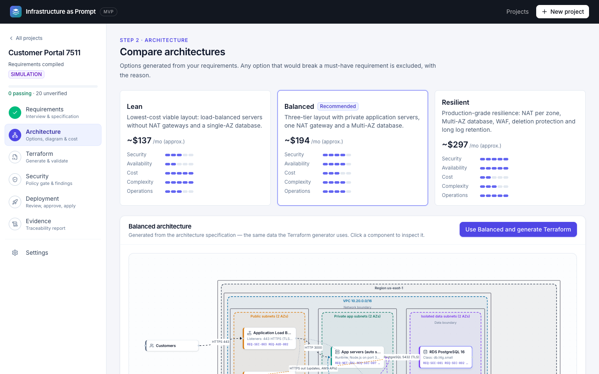
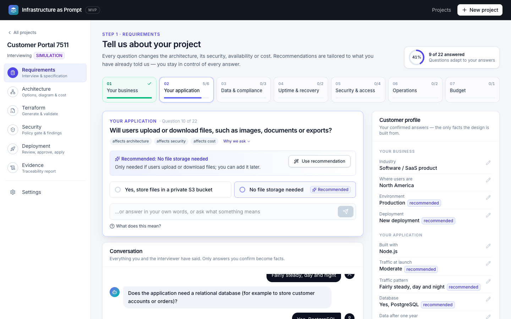
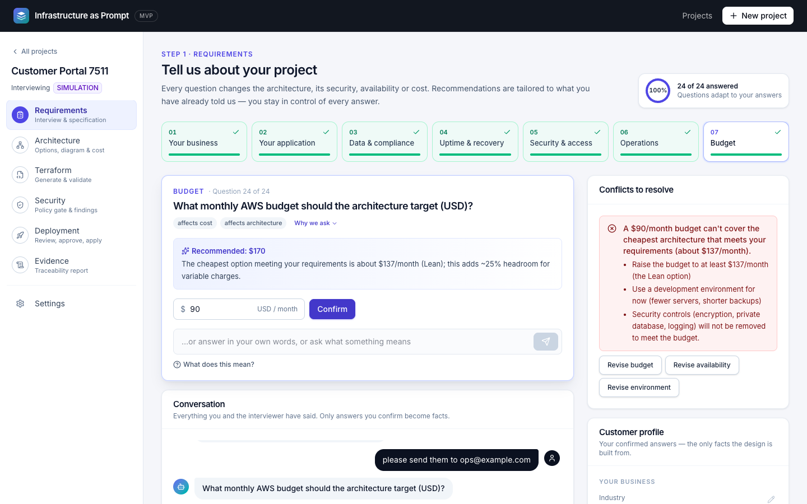
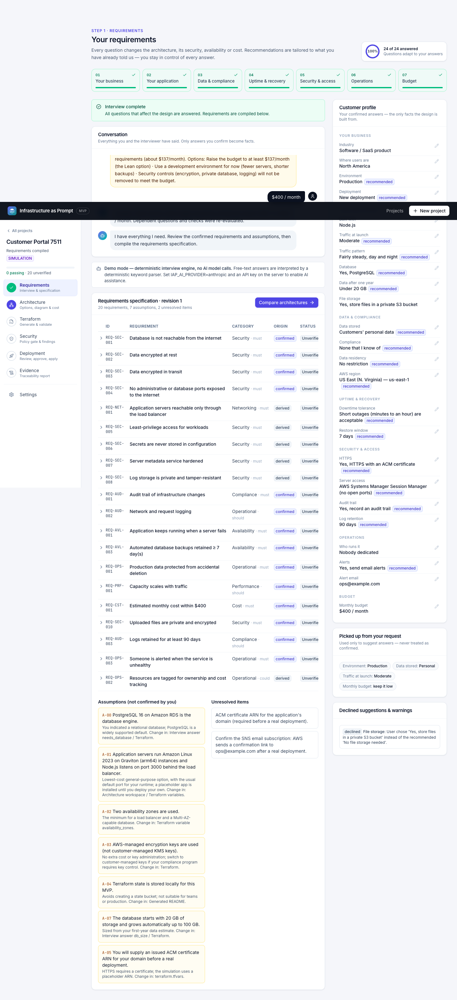
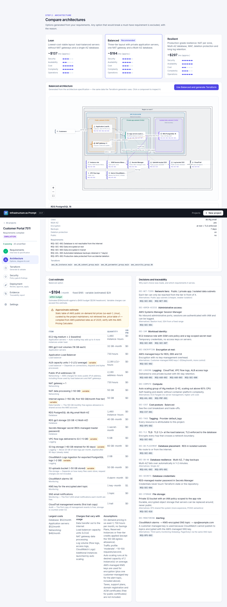
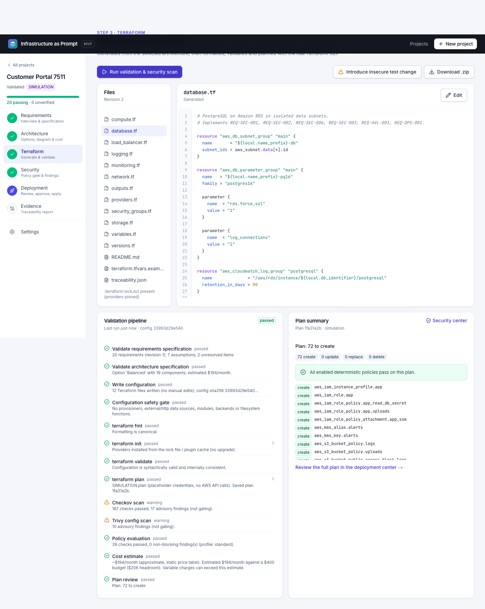
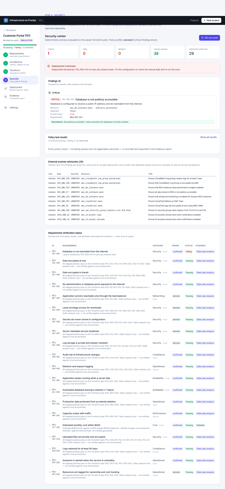
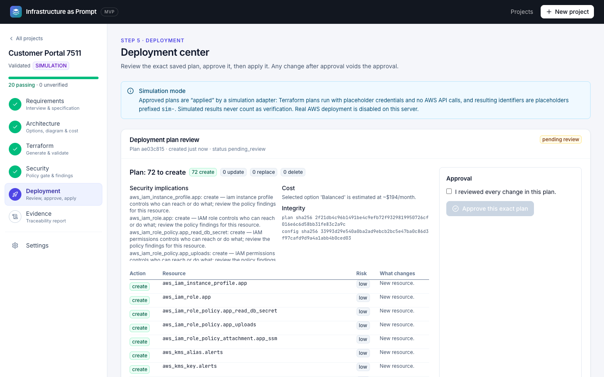
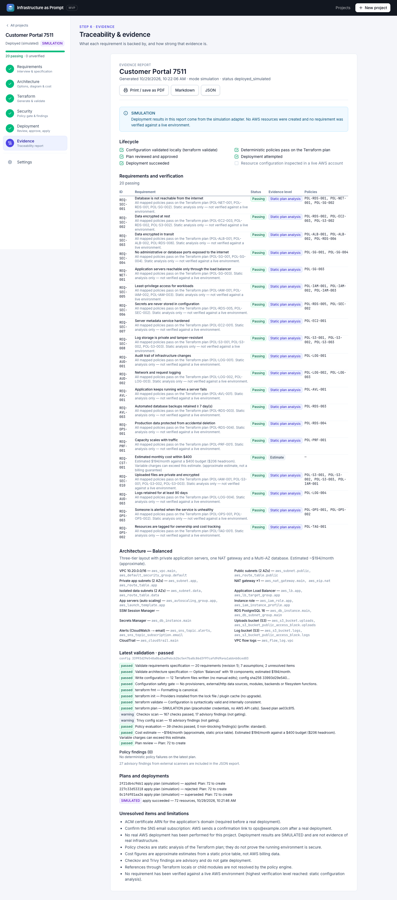
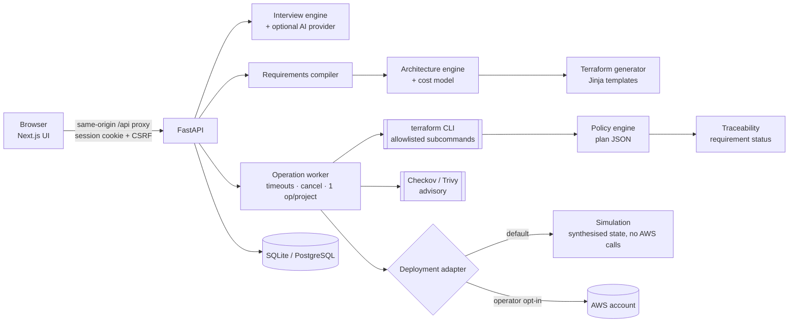

# Infrastructure as Prompt (IaP)

**A security-first platform that turns plain-English infrastructure requirements into enforceable AWS requirements, reviewed Terraform, a deterministic policy gate, and evidence of what was — and was not — verified.**



[](https://codespaces.new/ahmedhany-cys/infrastructure-as-prompt?quickstart=1)
[](https://github.com/ahmedhany-cys/infrastructure-as-prompt/actions/workflows/try-it.yml)

> **Status: working MVP.** AWS only. Runs in **simulation mode** by default: no cloud resources are created unless a server operator explicitly enables real deployments. No real AWS deployment has been performed with this codebase yet (see [Limitations](docs/limitations-and-roadmap.md)).

## Try it

**In your browser, nothing to install:** click **Open in GitHub Codespaces** above, then **Create codespace**. GitHub builds a private environment with Python, Node.js and Terraform, starts the app, and opens it in a new tab after a few minutes (the first start takes longest). Choose **Start with this example** and follow the interview. It runs on your own GitHub account's free Codespaces allowance; stop the codespace when you're done.

**On your machine with Docker:**

```bash
git clone https://github.com/ahmedhany-cys/infrastructure-as-prompt.git
cd infrastructure-as-prompt
docker compose up --build
```

Then open http://localhost:3000 — `localhost` means your own computer, so this link works only while the containers are running. Both options run in **simulation mode**: no AWS account or credentials are needed, and no cloud resources are created.

To run it without Docker, see [Quick start](#quick-start-local-simulation-mode).

## The problem

Small IT companies and software teams without a dedicated cloud architect describe what they need in business terms — *"secure, handles growth, protects customer data, cheap"* — and get back either a generic template or AI-generated Terraform that nobody can vouch for. Natural-language-to-Terraform tools make it *faster* to produce infrastructure; they do not make it *trustworthy*:

- business intent is lost between the conversation and the code,
- security depends on whatever the model happened to write,
- nothing proves that the deployed result satisfies the original request.

## What IaP does differently

| Capability | How it works |
|---|---|
| **Tailored requirements interview** | Up to 27 questions in seven sections — your business, application, data & compliance, uptime & recovery, security & access, operations and budget — each asked only if it changes the architecture, security, availability or cost. Recommendations adapt to the customer: industry, user location, runtime, traffic pattern, file storage, restore window, log retention and who runs the system all shape the suggested answers and the generated infrastructure (app port and instance size, scaling headroom, an off-hours schedule, a private uploads bucket, alarms to the team). Free-text answers are parsed (deterministically, or by an optional AI model whose output is validated against the allowed options). Contradictions — e.g. EU-only data in a US region, or a budget below the cheapest compliant design — block completion with concrete options. Unsafe answers (plain HTTP for personal data, SSH from `0.0.0.0/0`) are refused and recorded. |
| **Infrastructure Requirements Compiler** | Confirmed answers become a versioned specification of about 20 requirements (`REQ-SEC-001 Database is not reachable from the internet`, …), each with category, priority, severity, origin (*confirmed / derived / assumption*), mapped architecture decisions, Terraform resources, deterministic policies and a verification method. |
| **Deterministic policy engine** | 38 AWS policies evaluate the **Terraform plan JSON** (planned values + the configuration reference graph), not regexes over text and not an LLM. Critical findings block approval. Checkov and Trivy run alongside as advisory scanners. |
| **Architecture options & diagram** | Lean / Balanced / Resilient options are generated from the requirements; options that violate a *must* requirement are excluded with the reason. The React Flow diagram, the cost model and the Terraform generator all read the same architecture specification. |
| **Budget-aware cost model** | Itemised monthly estimates (compute, RDS, Multi-AZ, ALB + LCUs, NAT + data processing, public IPv4, egress, logs, WAF, Secrets Manager) with assumptions and variable charges, clearly labelled approximate. Security controls are never removed to meet a budget. |
| **Real Terraform pipeline** | `fmt → init → validate → plan → show -json → policies → Checkov → Trivy → cost → plan review`, run by the real Terraform CLI in a sandboxed subprocess. |
| **Saved-plan approval workflow** | Approval binds to the SHA-256 of the saved plan file *and* of the configuration. Any change voids it. Destructive plans need a separate acknowledgement plus the typed project name. |
| **Evidence with honest levels** | Requirement status is derived only from policy results, cost estimates and inspection evidence: *none → estimate → static plan analysis → live AWS inspection*. Simulated deployments are recorded as evidence but never raise the level. JSON, Markdown and print-to-PDF exports. |

## Screenshots (captured from the running application)

| | |
|---|---|
|  Tailored question with the live customer profile |  Interview with a budget conflict |
|  Compiled requirements |  Options and cost breakdown |
|  Terraform + validation pipeline |  Deliberately insecure change blocked |
|  Human-readable plan review |  Evidence report |

All 13 screenshots are in [`docs/screenshots/`](docs/screenshots); they were captured by the Playwright journey test against the real UI and backend.

## How the interview tailors the design

| You tell it | It changes |
|---|---|
| Industry (SaaS, e-commerce, healthcare, finance, education, public sector, agency) | Recommended data class, compliance framework, availability, file storage and log retention |
| Where your users are | Suggested region (closest supported region for the Middle East, Africa and Asia-Pacific) |
| Runtime (Node.js, Python, Java, .NET, Go, PHP, Ruby) | Load balancer → app port, and one instance size larger for JVM/.NET |
| Traffic pattern (steady, business hours, spiky) | Spiky: twice the scaling headroom, scale out at 50 % CPU. Business hours in dev/staging: servers off nights and weekends (~64 % less compute) |
| Data volume, file uploads | Database storage size; a private, encrypted, versioned uploads bucket with an IAM policy scoped to it |
| Restore window, log retention | Backup retention (1–35 days) and log lifecycle (30 days – 6 years), with framework minimums enforced |
| Who runs it, alerts | CloudWatch alarms (5xx, unhealthy servers, DB CPU and storage) to your team through a KMS-encrypted SNS topic |

Every recommendation is explained and can be declined; security controls are never removed. The request text is scanned for these details too ("online store built with Django, Black Friday spikes…"), but only as suggestions.

The UI is a project workspace with a lifecycle sidebar (Requirements → Architecture → Terraform → Security → Deployment → Evidence), a sectioned interview with per-section progress, one-click "use recommendation", and a live customer profile of confirmed answers.

## Architecture



Details: [docs/architecture.md](docs/architecture.md).

## Quick start (local, simulation mode)

Prerequisites: Python 3.12+, Node.js 20+, Terraform ≥ 1.6 (tested with 1.17.0). Optional: Checkov, Trivy.

```bash
cd backend
python3 -m venv .venv && .venv/bin/pip install -r requirements.txt
cp .env.example .env    # then set IAP_SECRET_KEY to a long random value
.venv/bin/python -m uvicorn app.main:app --port 8000
```

```bash
cd frontend
npm install
npm run dev             # http://localhost:3000
```

The first validation run downloads the AWS provider (~100 MB) into `backend/var/plugin-cache/`. Full instructions, PostgreSQL setup and optional tools: [docs/setup.md](docs/setup.md).

## Reproduce the demonstration

Open http://localhost:3000 → **Start with this example** → follow [docs/demo-walkthrough.md](docs/demo-walkthrough.md) (about 5 minutes), or run the automated journey:

```bash
cd frontend
npx playwright test     # drives all 15 steps through the UI and refreshes docs/screenshots
```

## Tests

| Suite | Command | Result (2026-10-29) |
|---|---|---|
| Backend unit + API integration + scenario (116 tests, incl. real `terraform validate` on 8 variants and a real `plan`/simulated apply) | `cd backend && .venv/bin/python -m pytest` | **116 passed** (see note in [testing](docs/testing.md)) |
| Backend lint / format / types | `ruff check`, `ruff format --check`, `mypy app` | clean |
| Frontend unit (Vitest) | `npm test` | **7 passed** |
| Frontend lint / types / production build | `npm run lint`, `npm run typecheck`, `npm run build` | clean / clean / success |
| End-to-end UI journey (Playwright, Chrome) | `npx playwright test` | **1 passed** (no console errors) |

What is and isn't tested: [docs/testing.md](docs/testing.md).

## Security model in one paragraph

The AI layer is optional and narrow: it may suggest hints and map free-text answers to one of the current question's allowed values; it cannot write Terraform, run commands, approve plans or mark anything verified. Terraform is executed only through an allowlist of subcommands with argv lists (no shell), a minimal environment, timeouts, output caps and process-group kill. Simulation runs receive placeholder credentials with the host's AWS config files disabled. Projects are isolated per signed workspace session; state-changing requests require a CSRF token; expensive operations are rate-limited; sensitive actions are audit-logged. Full model and threat analysis: [docs/security-model.md](docs/security-model.md).

## Documentation

- [Architecture](docs/architecture.md)
- [Security model & threat model](docs/security-model.md)
- [Requirements compiler](docs/requirements-compiler.md)
- [Terraform generation, validation & policies](docs/terraform-pipeline.md)
- [API reference](docs/api.md)
- [Setup](docs/setup.md) · [Testing](docs/testing.md) · [Demo walkthrough](docs/demo-walkthrough.md)
- [AWS deployment, cost & cleanup](docs/aws-deployment.md)
- [Limitations & roadmap](docs/limitations-and-roadmap.md)
- Examples from a real run: [requirements spec](docs/examples/requirements-spec.json) · [security findings](docs/examples/security-findings-insecure.json) · [evidence report](docs/examples/evidence-report.md) · [generated Terraform](docs/examples/generated-terraform)

## Third-party software

Built on FastAPI, Pydantic, SQLAlchemy, Alembic, Jinja2, Next.js, React, Tailwind CSS, React Flow (`@xyflow/react`), lucide-react, and the Anthropic Python SDK (optional). Uses HashiCorp Terraform and the AWS provider at runtime, and optionally Checkov (Bridgecrew/Prisma Cloud) and Trivy (Aqua Security). Each is used under its own license.

## License

MIT — see [LICENSE](LICENSE).
