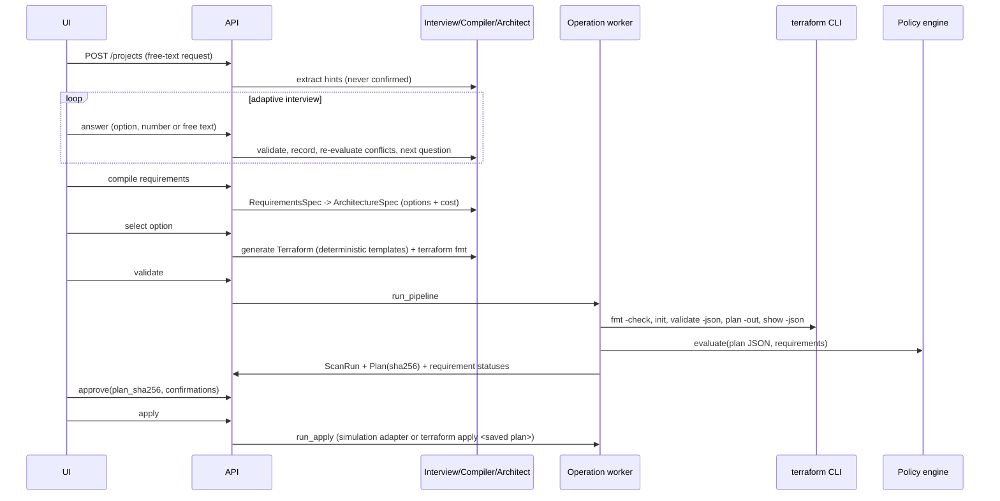

# Architecture

## Components

```
frontend/  Next.js 16 (App Router) + TypeScript + Tailwind CSS 4 + React Flow
backend/   FastAPI + Pydantic 2 + SQLAlchemy 2 (+ Alembic)
  app/domain/          Pydantic schemas: interview, requirements, architecture, findings
  app/services/
    interview_engine   question bank, applicability, recommendations, conflicts, parser
    ai_provider        Demo (deterministic) and Anthropic providers, output validation
    compiler           interview facts -> RequirementsSpec
    architect          RequirementsSpec -> ArchitectureSpec (options, components, decisions)
    pricing            static price table + itemised cost model
    terraform/         generator (Jinja templates), runner (sandboxed CLI), workspace
    policy/            graph (plan JSON -> resources + reference graph), rules, engine, external
    pipeline           the validation pipeline (an operation)
    plan_review        plan JSON -> human-readable review
    deploy/            approval gate, apply (simulation/real), teardown, simulated state
    verification       post-deployment checks (live AWS read-only, or simulated)
    traceability       evidence -> requirement status
    evidence           JSON / Markdown evidence report
    operations         background worker, cancellation, restart recovery
  app/api/             HTTP routes (projects/interview/requirements/architecture/settings, workflow)
  app/security.py      sessions, CSRF, rate limiting
```

## Data flow



## Single source of truth

`ArchitectureSpec.options[*].params` drives three consumers:

1. **Diagram** — `components` and `connections` are derived from the params; the frontend only lays them out (`frontend/src/lib/diagram-layout.ts`) and never invents nodes. Shared services (IAM, Session Manager, Secrets Manager, uploads bucket, log bucket, CloudTrail, flow logs, alerts) wrap onto a second row when there are more than six.
2. **Cost model** — `pricing.estimate(params, …)`.
3. **Terraform** — `generator.generate(…, option)` renders templates with the same params.

A test (`test_diagram_components_reference_generated_terraform`) checks that every Terraform address a diagram component claims to implement exists in the generated configuration.

## Persistence

| Table | Content |
|---|---|
| `workspace_sessions` | anonymous browser workspaces (isolation boundary) |
| `projects` | settings, interview state, requirements spec, architecture spec, generated files, manual edits (kept separately), config revision |
| `scan_runs` | pipeline steps, policy results, external findings, summary, config hash |
| `plans` | saved plan path, plan sha256, config sha256, review, status, approval |
| `deployments` | mode, kind, resources, verification checks, log |
| `operations` | background operation status, progress, log |
| `audit_logs` | sensitive actions |

SQLite is the default for local use (`backend/var/iap.db`); set `IAP_DATABASE_URL` to PostgreSQL and run `alembic upgrade head` for multi-user deployments. Timestamps are stored and returned as timezone-aware UTC on both engines.

Terraform workspaces live in `backend/var/workspaces/<project>/<simulation|aws>/`; simulation and real workspaces never share state.

## Simulation adapter

Simulation is not a mock that pretends to run Terraform. It runs the real CLI:

- `plan` uses placeholder credentials, `skip_*` provider flags and `-refresh=false` (written into a `simulation_override.tf` that is never exported), so it makes no AWS API calls.
- "Apply" builds a Terraform state file from the approved plan's planned values, filling identifier-like unknowns with deterministic `sim-…` placeholders (AWS-style prefixes where the provider validates them), then re-plans until the state converges to "no changes" (typically 4 rounds).
- Subsequent plans therefore show genuine Terraform diffs — updates, replacements and destroys — and teardown produces a real destroy plan.

All simulated results are labelled `SIMULATED` in the UI, API and evidence report, and never raise a requirement's verification level.

## Operations

Pipeline, apply and teardown-plan run as background operations (thread pool, one active operation per project). Each has a cancel flag checked between steps and inside the subprocess wait loop (process-group kill). On startup, operations left `running` are marked `interrupted` with an explanation; no partial result is recorded as success.
