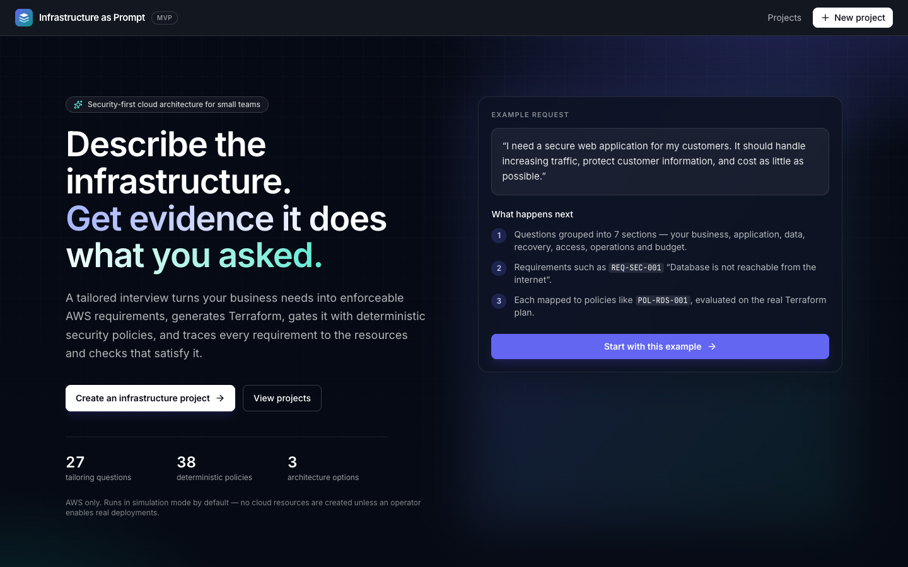
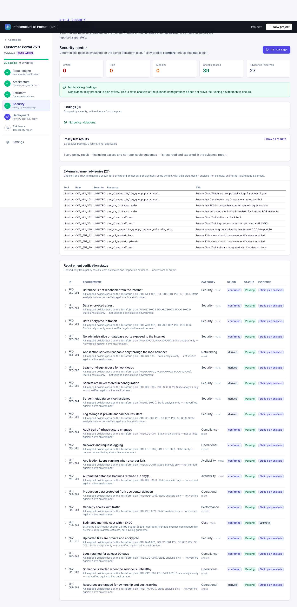
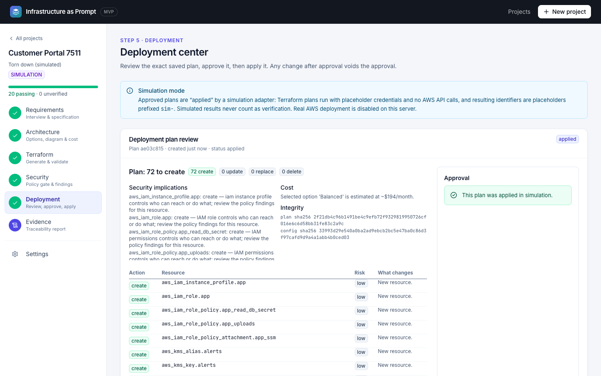

# Demo walkthrough (≈ 5 minutes, simulation mode)

The scenario: a small IT company needs a secure customer-facing web application with a database, controlled network access, reasonable scalability, auditability and a monthly budget. Every screenshot below was captured from the running application by the Playwright journey (`frontend/e2e/full-journey.spec.ts`).

## 1. Describe the need

Landing page → **Start with this example**. The request is pre-filled: *"I need a secure web application for my customers. It should handle increasing traffic, protect customer information, and cost as little as possible."*

## 2. Tailored interview

The engine notes what it detected (production, personal data, growing traffic, cost sensitivity) but asks you to confirm each. Questions are grouped into seven sections shown across the top with their progress; confirmed answers build up in the **Customer profile** panel, where any of them can be revised.

Answer by clicking an option, pressing **Use recommendation**, or typing — for the first question try *"we sell software subscriptions to businesses"* (interpreted as SaaS). Ask *"what does that mean?"* or open **Why we ask** for an explanation. The journey answers: North America, production, new deployment, Node.js, moderate and steady traffic, a database under 20 GB, file uploads, personal data, no framework, no residency restriction, us-east-1, short outages acceptable, a 7-day restore window, HTTPS, Session Manager, audit trail, 90-day logs, no dedicated ops person, and email alerts to *ops@example.com*.

Try entering a **$90** budget: the interview refuses to finish, explains that the cheapest compliant design costs about $137/month, and offers options — none of which remove security controls. Revise the budget to **$400**.

To see the tailoring change the design, start a project from the **Online store** or **Internal tool (staging)** examples on the new-project page: the first leads to high availability and a file bucket being recommended; the second offers to switch servers off outside business hours.

## 3. Review structured requirements

**Compile requirements specification** produces 20 requirements — including the tailored ones for file storage (`REQ-SEC-010`), log retention (`REQ-AUD-003`) and alerting (`REQ-OPS-003`) —, each with policies, resources and origin, plus assumptions (not confirmed by you) and unresolved items. Expand a row to see its traceability.

## 4–6. Compare architectures, inspect the diagram, review costs

Three options are offered for this scenario (Lean ~$137, Balanced ~$194, Resilient ~$297/month, approximate). Balanced is recommended for production within budget. Click components (e.g. the database) to see why they exist, their security boundary, the requirements they satisfy and their Terraform addresses. Scroll for the itemised cost breakdown, assumptions and variable charges.

## 7–8. Generate Terraform and validate

**Use Balanced and generate Terraform** → **Run validation & security scan**. The pipeline runs the safety gate, `terraform fmt/init/validate/plan`, 38 deterministic policies, Checkov and Trivy (advisory) and the cost estimate. Expand any step to see tool output.

## 9. Introduce an insecure configuration

**Introduce insecure test change → Make the database publicly accessible** edits `database.tf` (`publicly_accessible = true`). Re-run validation: `POL-RDS-001` fails on `aws_db_instance.main` with expected/actual values from the plan, `REQ-SEC-001` turns **failing**, and the plan is **rejected** — it cannot be approved.

## 10. Correct and re-run

Open `database.tf` → **Revert to generated** → run validation again. All enabled policies pass.

## 11–12. Review and approve the plan; simulated deployment

The deployment center shows counts, every change with its risk, security implications, cost and the plan/config SHA-256. Tick *I reviewed every change*, **Approve this exact plan**, then **Run simulated deployment**. The simulation creates no AWS resources; identifiers are `sim-…` placeholders.

## 13–14. Traceability and evidence

The evidence report shows each requirement's status and evidence level (static plan analysis — not live inspection), the lifecycle stages reached, findings, plans, the simulated deployment and the limitations. Export as JSON or Markdown, or print to PDF.

## 15. Teardown

**Plan teardown** creates a real Terraform destroy plan against the simulated state. Approval requires acknowledging destruction and typing the project name.

Bonus: after deploying, change something (e.g. switch the architecture option) and re-validate — the plan review will show genuine updates and destroys (NAT gateway, private subnets) flagged as destructive.
